# Metro for MiSTer

FPGA core of the **Metro** arcade boards (Metro Corp., 1994 - 1996) built on the Imagetek I4100 / I4220 / I4300 video chips, for the MiSTer. Written from MAME 0.289's
`metro.cpp` and `imagetek_i4100.cpp`; MAME was the oracle for everything (video chip state, 68000 bus writes, sound), and the result is checked against it in simulation and
on a real MiSTer. No ROMs or other copyrighted data are in this repository: you supply your own MAME 0.289 romsets.

## Three core files

One source tree builds three core files. The MiSTer's FPGA (Cyclone V 5CSEBA6: 41,910 ALMs, 553 RAM blocks) is too small for every family at once: a build with all of it needs
116 % of the logic, so each core file leaves out what its games do not need.

| Core file | Needs | Games |
|---|---|---|
| `metro_<date>.rbf` | the standard 32 MB SDRAM module | Dharma Doujou, Toride II, Gun Master, Pururun, Daitoride (plain version), Puzzli, The Karate Tournament, Lady Killer / Moeyo Gonta, Pang Pom's, Sky Alert, Last Fortress - Toride, Poitto!, Sankokushi, Mouja, Mahjong Doukyuusei (+ Special), Varia Metal |
| `metrod64_<date>.rbf` | a **64 MB** SDRAM module | Mouse Shooter GoGo, Bal Cube, Bang Bang Ball, Battle Bubble, Daitoride (YMF278B version), Mahjong Gakuensai 1 / 2 (32 MB of graphics) |
| `metrof64_<date>.rbf` | a **64 MB** SDRAM module | Blazing Tornado, Grand Striker 2 (the Konami 053936 plane and the Z80 + YM2610 sound board) |

The MRAs name the right core file, so you only have to put all three RBFs in `_Arcade/cores/` and the MRAs in `_Arcade/`. Not supported: Puzzlet (an H8/3007 board that MAME 0.289
does not run either), Metabee Shot (its protection MCU has no dump) and Poitto! revision C (one ROM has no known good dump).

## Screenshots

The titles of the three core files: their title or attract screens, as MAME 0.289 draws them (to show what kind of games these are).

**`metro`** (32 MB module)

| | | |
|---|---|---|
| 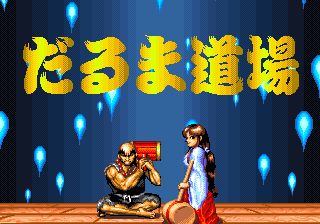 | 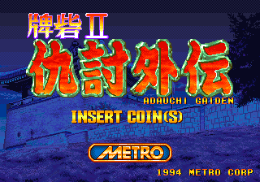 | 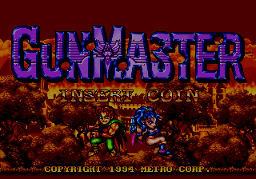 |
| Dharma Doujou | Toride II Adauchi Gaiden | Gun Master |
| 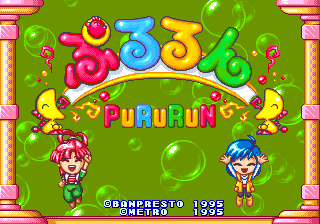 | 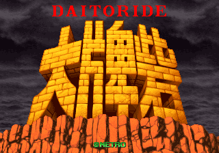 |  |
| Pururun | Daitoride | Puzzli |
| 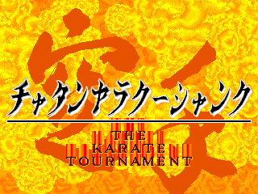 |  | 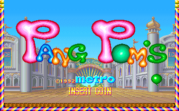 |
| The Karate Tournament | Lady Killer | Pang Pom's |
| 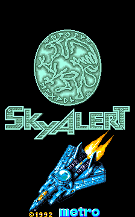 | 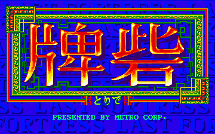 | 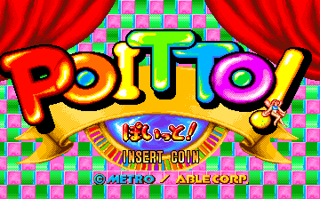 |
| Sky Alert | Last Fortress - Toride | Poitto! |
| 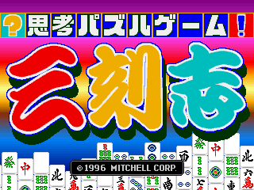 | 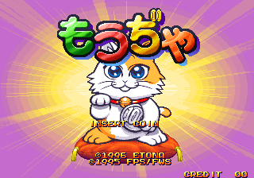 | 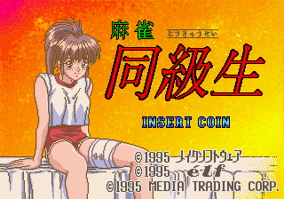 |
| Sankokushi | Mouja | Mahjong Doukyuusei |
| 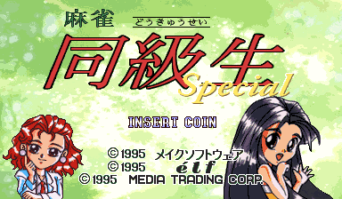 | 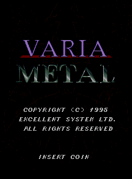 |  |
| Mahjong Doukyuusei Special | Varia Metal |  |

**`metrod64`** (64 MB module)

| | | |
|---|---|---|
| 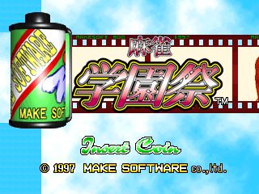 | 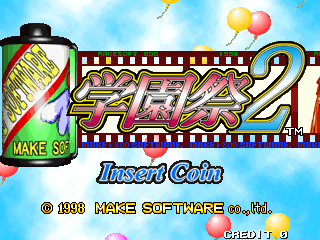 | 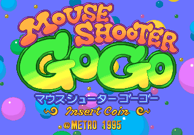 |
| Mahjong Gakuensai | Mahjong Gakuensai 2 | Mouse Shooter GoGo |
| 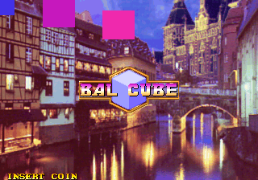 | 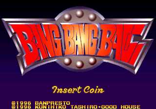 |  |
| Bal Cube | Bang Bang Ball (and Battle Bubble) |  |

**`metrof64`** (64 MB module)

| | | |
|---|---|---|
| 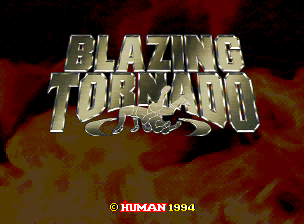 | 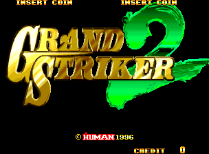 |  |
| Blazing Tornado | Grand Striker 2 |  |

## Install

The zip of a GitHub release unpacks over the root of the SD card. By hand:

1. Put `releases/metro_<date>.rbf`, `metrod64_<date>.rbf` and `metrof64_<date>.rbf` in `/media/fat/_Arcade/cores/` and the contents of `mra/` in `/media/fat/_Arcade/`
   (the other versions of a title are in `_alternatives/_<Title>/`). Keep the RBF names and dates: MiSTer finds the core by the MRA's `<rbf>` name and takes the newest.
   **Delete older `metro*.rbf` files.**
2. Put your MAME 0.289 romsets in `/media/fat/games/mame/` (the merged set, or the split sets with their parent zip).
3. Start the game from the Arcade menu. The ROM takes a few seconds to load (up to 36 MB for Blazing Tornado and Gakuensai).
4. **Buttons:** if you used an earlier build, delete `/media/fat/config/inputs/Metro_input_*.map` or redo "Define Metro buttons" (Button 1, Button 2, Start, Coin, Button 3).

### `metro` (32 MB module)

| MRA | Set | ROM zips (MAME 0.289) |
|---|---|---|
| Dharma Doujou | dharma | dharma |
| &nbsp;&nbsp;Dharma Doujou (Germany) | dharmag | dharmag + dharma |
| &nbsp;&nbsp;Dharma Doujou (Japan) | dharmaj | dharmaj + dharma |
| &nbsp;&nbsp;Dharma Dojang - Mangchi Man (Korea) | dharmak | dharmak + dharma |
| Toride II Adauchi Gaiden (Japan) | toride2g | toride2g |
| &nbsp;&nbsp;Toride II (German) | toride2gg | toride2gg + toride2g |
| &nbsp;&nbsp;Toride II Bok Su Oi Jeon Adauchi Gaiden (Korea) | toride2gk | toride2gk + toride2g |
| &nbsp;&nbsp;Toride II (Japan, revision K) | toride2j | toride2j + toride2g |
| &nbsp;&nbsp;Toride II (Japan, revision I) | toride2ji | toride2ji + toride2g |
| Gun Master | gunmast | gunmast |
| Pururun (Japan set 1) | pururun | pururun |
| &nbsp;&nbsp;Pururun (Japan set 2) | pururuna | pururuna + pururun |
| Daitoride (Japan) | daitorid | daitorid |
| Puzzli (Japan revision B) | puzzli | puzzli |
| &nbsp;&nbsp;Puzzli (Japan revision A) | puzzlia | puzzlia + puzzli |
| The Karate Tournament | karatour | karatour |
| &nbsp;&nbsp;Chatan Yara Kuushanku - The Karate Tournament (Japan) | karatourj | karatourj + karatour |
| Lady Killer (vertical) | ladykill | ladykill |
| &nbsp;&nbsp;Moeyo Gonta!! (Japan) | moegonta | moegonta + ladykill |
| Pang Pom's | pangpoms | pangpoms |
| &nbsp;&nbsp;Pang Pom's (Mitchell) | pangpomsm | pangpomsm + pangpoms |
| &nbsp;&nbsp;Pang Pom's (Nova) | pangpomsn | pangpomsn + pangpoms |
| Sky Alert (vertical) | skyalert | skyalert |
| Last Fortress - Toride (Japan, VG420 PCB) | lastfort | lastfort |
| &nbsp;&nbsp;Last Fortress - Toride (China, Rev C) | lastforte | lastforte + lastfort |
| &nbsp;&nbsp;Last Fortress - Toride (China, Rev A) | lastfortea | lastfortea + lastfort |
| &nbsp;&nbsp;Last Fortress - Toride (Korea) | lastfortk | lastfortk + lastfort |
| &nbsp;&nbsp;Last Fortress - Toride - Mah-jong (Germany) | lastfortg | lastfortg + lastfort |
| &nbsp;&nbsp;Last Fortress - Toride (Japan, VG460 PCB) | lastfortj | lastfortj + lastfort |
| Poitto! (Japan revision D) | poitto | poitto |
| Sankokushi (Japan) | 3kokushi | 3kokushi |
| Mouja (Japan) | mouja | mouja |
| Mahjong Doukyuusei (Japan) | dokyusei | dokyusei |
| Mahjong Doukyuusei Special (Japan) | dokyusp | dokyusp |
| Varia Metal | vmetal | vmetal |
| &nbsp;&nbsp;Varia Metal (New Ways Trading Co.) | vmetaln | vmetaln + vmetal |

### `metrod64` (64 MB module)

| MRA | Set | ROM zips (MAME 0.289) |
|---|---|---|
| Mouse Shooter GoGo | msgogo | msgogo |
| Bal Cube (Japan) | balcube | balcube |
| Bang Bang Ball (v1.05) | bangball | bangball |
| &nbsp;&nbsp;Battle Bubble (v2.00) | batlbubl | batlbubl + bangball |
| &nbsp;&nbsp;Daitoride (Japan, YMF278B version) | daitorida | daitorida + daitorid |
| Mahjong Gakuensai (Japan, set 1) | gakusai | gakusai |
| &nbsp;&nbsp;Mahjong Gakuensai (Japan, set 2) | gakusaia | gakusaia + gakusai |
| Mahjong Gakuensai 2 (Japan) | gakusai2 | gakusai2 |

### `metrof64` (64 MB module)

| MRA | Set | ROM zips (MAME 0.289) |
|---|---|---|
| Blazing Tornado | blzntrnd | blzntrnd |
| Grand Striker 2 (Europe and Oceania) | gstrik2 | gstrik2 |
| &nbsp;&nbsp;Grand Striker 2 (Japan) | gstrik2j | gstrik2j + gstrik2 |

`tools/make_mra.py` writes the MRAs from MAME's ROM lists and `-listxml` DIP switches; `tools/mra_verify.py` checks that each builds the same image as the one the simulations ran.

## Controls

| | |
|---|---|
| Joystick | directions, Button 1, Button 2, Button 3, Start, Coin (Dharma: button 1 only; Gun Master uses all three) |
| Keyboard | 1 / 2 start, 5 / 6 coin, 9 service |
| Mahjong panel (Mahjong Doukyuusei, Doukyuusei Special, Mouja, Gakuensai 1 / 2, Last Fortress Mah-jong) | keyboard, MAME's defaults: letters A-N, Left Ctrl = Kan, Left Shift = Reach, Space = Chi, Left Alt = Pon, Z = Ron, 1 = Start, 5 = Coin |

The joystick word is laid out by the MRA's `<buttons>` list (bit 4 = first name): keep it in step with `Metro.sv` if you write your own MRA.

## OSD options

| Option | Values | |
|---|---|---|
| Aspect ratio | Original, Full Screen, [ARC1], [ARC2] | Original is 4:3 |
| Scandoubler Fx | None, HQ2x, CRT 25 / 50 / 75 % | |
| Display window | Game's CRTC, MAME | the chip's own CRTC window or MAME's fixed lines 0 - 223 (flipped, the window is always MAME's) |
| Rotate screen | On, Off | only on the vertical games (Sky Alert, Lady Killer, Moeyo Gonta): On turns the picture upright through the framebuffer |
| CRT Adjust (a page of its own) | Off / On, H-Size, H-Position, V-Shift | for the analog output of every game, after rmonic79's [MiSTer-CRT-Adjust](https://github.com/rmonic79/MiSTer-CRT-Adjust) (`modules/crt_adjust`) |
| DIP switches | per game | the MRA's switches (coinage, difficulty, Flip Screen, Service Mode, ...); most are read by the game at start-up: change them and press Reset. **Flip Screen is the exception: the core flips the picture itself at once** |
| Volume | Normal, -6 dB, -12 dB, +6 dB | |
| Reset | | restarts the machine |

The hardware test switches of the development builds (SDRAM read capture, Debug overlay, Plane fetch priority, CPU sprite write hold, Sound board, Tile RAM frame sync) are not in
the release cores; build with `METRO_DEBUG` (see Build) to get them back. Every one is at the setting that was tested on the boards (the frame-synchronous tile RAM is on in `metrof64`).

## Status

**Verification.** MAME 0.289 is the reference. In simulation (Verilator, the games' real programs, the real SDRAM path): the video chip's memories and registers equal MAME's word
for word after a coin and a start for every family; the sound CPU (uPD78C10) runs in lock-step with MAME's own code; the sound levels are fitted against MAME's recordings; the
YMF278B's output is compared with ymfm (the code MAME 0.289 runs) fed with the writes of the real games; the Blazing Tornado / Grand Striker 2 plane was checked against MAME by replay
of the games' own writes. `docs/status.md` has the measured results, the bugs found on the way and the open points.

**On a real MiSTer** (the owner's, with a 64 MB module for the 64 MB cores):

* `metrof64`: Blazing Tornado and Grand Striker 2 play, picture and sound; the frame-synchronous tile RAM removed the flickering band of the continue screen and the dashes of
  Grand Striker 2's title.
* `metrod64`: Mouse Shooter GoGo, Bal Cube, Daitoride (YMF278B version), Bang Bang Ball, Battle Bubble and Mahjong Gakuensai 1 / 2 play well, the YMF278B sounds right. The
  graphical glitches that Gakuensai 1 and 2 showed in 20261012 / 20261013 (flashing blocks on the girls, garbled mouth patches) are gone with the blit queue of 20261014a.
* `metro`: hardware reports exist for Dharma Doujou, Toride II, Gun Master, Pururun, Daitoride, Puzzli, The Karate Tournament, Lady Killer, Pang Pom's, Sky Alert, Last
  Fortress, Poitto!, Mahjong Doukyuusei (+ Special) and Varia Metal. Sankokushi and Mouja are verified in simulation only (no hardware report on file).

**Known issues**

* Daitoride (the plain version, `metro`): single torn scanlines on the rising rocks (the YMF278B version on `metrod64` does not show them).
* Mahjong Doukyuusei: a bright frame in some portrait scenes. The Karate Tournament: rectangles in explosions were reported on an earlier build and not re-checked.
* Mouse Shooter GoGo (`metrod64`): small quirks (flashing lines in the busy scenes, the title scroll); a replay of MAME's own writes matches MAME to a few hundred pixels,
  the cause is not found.
* Bang Bang Ball and Battle Bubble run at the core's 58.2 Hz (MAME: 60 Hz). Mahjong Gakuensai's EEPROM (settings) is not saved.
* The family C boards' 68000 gets its program through the SDRAM cache: ROM reads wait 2 clocks on average (99.9 % within 8 clocks in simulation), and a loop of Gakuensai's runs at
  MAME's speed within 0.3 %. (An earlier note of "a quarter slower" counted bus cycles per frame, which is the bus utilisation, not the speed.)

## Video and sound

The picture is MAME's: a 392 x 263 raster at 6.0 MHz dots (58.23 Hz) with the I4220's 320 x 224 (the 360-pixel games are re-timed for a CRT, `rtl/metro_vout.sv`). The renderer
is Hyper Duel's (see Credits) with the Metro changes marked `METRO:` in `rtl/metro_render.sv` and `rtl/metro_vdp.sv`. Family F adds the 053936 plane (`rtl/metro_roz.sv`).

Sound: the real uPD78C10 running the game's program with YM2413 (IKAOPLL) or YM2151 (jt51) and OKI M6295 (jt6295) on the older boards, the ES8712 ADPCM on Varia Metal, the
Z80 + YM2610 (jt10) on Blazing Tornado / Grand Striker 2, and the YMF278B (OPL4) on the family C boards, which the 68000 drives itself.

## Build

Quartus Prime Lite **17.0.2** (the version MiSTer's framework needs). The project has three revisions, one per core file (settings in `Metro.qsf`, the revision files are derived by
`tools/make_revisions.py`):

    quartus_sh --flow compile Metro -c Metro        -> output_files/Metro.rbf       the 32 MB core
    quartus_sh --flow compile Metro -c Metro_D64    -> output_files/Metro_D64.rbf   metrod64
    quartus_sh --flow compile Metro -c Metro_F64    -> output_files/Metro_F64.rbf   metrof64

Rename the RBF to `metro_<date>.rbf` / `metrod64_<date>.rbf` / `metrof64_<date>.rbf`. The design runs at 96 MHz with a few tenths of a ns of placement noise: the fitter seed matters
(`SEED` in each revision; the seeds that met timing for each release and the timing numbers are in `docs/status.md`). `build_id.v` holds the id shown in the OSD (`tools/make_revisions.py --id`).
`VERILOG_MACRO METRO_DEBUG` adds the hardware test switches back to the OSD. `tools/package.py <date>` writes the release zip from `releases/` and `mra/`.

## Simulation and tools

Verilator benches in `sim/` (run in WSL): the video chip against dumped MAME states (`tools/vtest.sh`), the whole board through the SDRAM model (`sim/run_sys.sh`, `DBUILD=1` /
`F64=1` / `VLOG=1` select the core variant), the sound CPU in lock-step (`sim/upd78c10/run_lockstep.sh`), the sound boards (`sim/run_sound.sh`, `sim/run_sndf.sh`) and the YMF278B
(`sim/run_ymf.sh`). `tools/lua/` has the MAME scripts that dump states and drive inputs; `tools/metro_ref.py` is the Python reference renderer. The tools find MAME's source and
executable through `tools/paths.py` (`METRO_BASE`, `METRO_MAME`).

## Repository layout

| | |
|---|---|
| `Metro.sv`, `Metro*.qsf`, `Metro.qpf`, `Metro.sdc`, `files.qip` | the MiSTer top level (OSD, inputs, DIP switches, video, audio) and the Quartus project with its three revisions |
| `rtl/` | the machine: 68000 board, I4220 / I4300 video chip (renderer, blitter, registers), 053936 plane, SDRAM controller, ROM loader and cache, uPD78C10, sound boards, YMF278B |
| `modules/` | other people's cores, with their licences (`modules/VENDOR.md`) |
| `sys/` | the MiSTer framework |
| `mra/` | the MRAs: one a title in the folder, the other versions in `_alternatives/_<Title>/` |
| `releases/` | the RBFs of the release with their fitter and timing summaries |
| `docs/` | `hardware.md` (what MAME says about the boards), `status.md` (results and process notes) |
| `tools/`, `sim/` | MRA writer / verifier, ROM-image builder, reference renderer, MAME scripts, benches |

## Credits

* **MAME** (the metro driver by Luca Elia and David Haywood, `imagetek_i4100` by them and Angelo Salese, `upd7810` by Juergen Buchmueller, `k053936`, `ymf278b`, all BSD-3-Clause
  or GPL-2.0+ as marked in their files): the hardware knowledge, the oracle for every comparison, and the source the uPD78C10's instruction handlers are generated from.
* **searchsolved's Arcade-HyperDuel_MiSTer**: the Imagetek I4220 renderer, blitter and register file this core's video chip is adapted from (GPL-3.0-or-later), and the
  vendored YM2413 / OKI setup. Its author's measurements of a real I4220 board are the reason the CRTC window option exists.
* **Jorge Cwik** (fx68k, GPL-3.0), **Raki / Sehyeon Kim** (IKAOPLL, BSD-2-Clause), **Jose Tejada (jotego)** (jt6295, jt51, jt10, jt49, GPL-3.0), **Guy Hutchison** (tv80, permissive),
  **rmonic79** (MiSTer-CRT-Adjust, GPL-3.0-or-later).
* **srg320** (the YMF278B / OPL4 PCM engine of Arcade-PsikyoSH2_MiSTer, derived from MAME's `ymf278b`, BSD-3-Clause; `rtl/ymf278b.sv`, with the Metro changes listed in its header).
  **Aaron Giles** (ymfm, BSD-3-Clause) was the reference the engine was checked against (not in the core).
* **The MiSTer framework** (Sorgelig and contributors); the SDRAM controller, loader and cache structure follow the owner's other cores (MCatAdv, Gaiapolis, Taito L).

## Licence

GPL-3.0-or-later (`LICENSE`); vendored modules and `rtl/ymf278b*.sv` keep their own licences.
